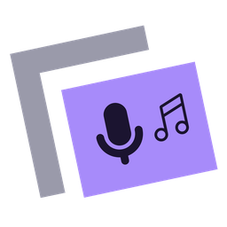
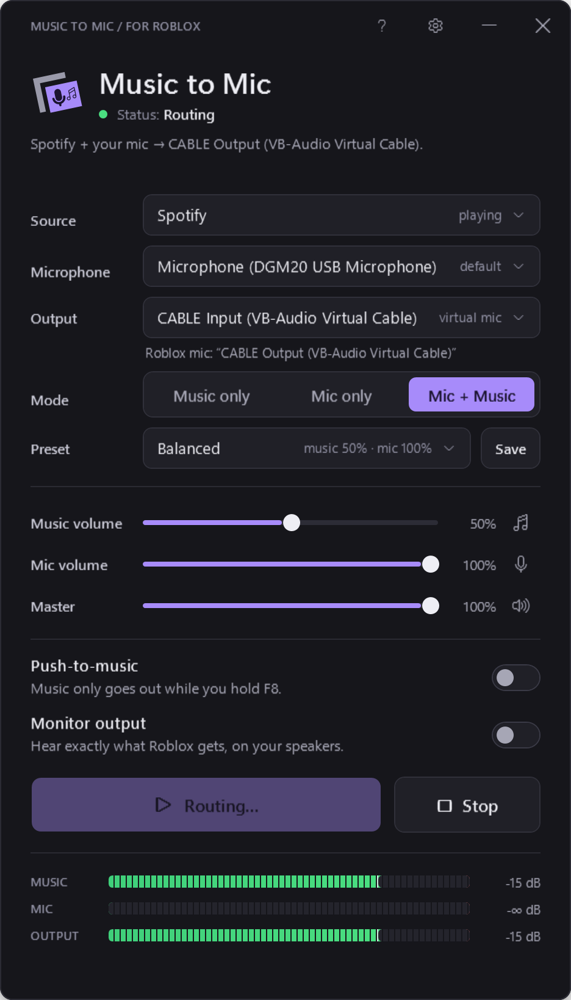

<p align="center">
  
</p>

<h1 align="center">Music to Mic for Roblox</h1>

<p align="center">Play music from Spotify, Chrome, YouTube or any app through your microphone in Roblox voice chat.<br>Made by xRed1.</p>

<p align="center">
  <a href="https://github.com/bloxnest/music-to-mic/releases/latest/download/MusicToMic.exe">Download</a> ·
  <a href="https://bloxnest.github.io/music-to-mic/guide.html">Setup guide</a> ·
  <a href="https://bloxnest.github.io/music-to-mic/">Website</a> ·
  <a href="PRIVACY.md">Privacy</a> ·
  <a href="SECURITY.md">Security</a>
</p>

<p align="center">
  
</p>

---

## What it does

- **Pick one app** as the music source (Spotify, Chrome, Edge, VLC, Discord...). Only that app is sent: Discord pings and Windows sounds aren't.
- **Three modes:** Music only, Mic only, or Mic + Music, each with its own volume, plus a master volume and mute buttons.
- **Push-to-music:** optionally, music only goes out while you hold a key (F8 by default, or a mouse side button).
- **Live meters** for the music, your mic and the final output (green, yellow, red), and a limiter so the mix never clips.
- **Presets:** Music, Background Music, Balanced, and your own.
- **Stays out of the way:** closes to the hidden icons and keeps routing; Roblox push-to-talk works as normal.

## Setup (once)

Windows can't create a new microphone without a driver, so Music to Mic plays into a free virtual audio cable:

1. Install **[VB-CABLE](https://vb-audio.com/Cable/)** (free, by VB-Audio): run `VBCABLE_Setup_x64.exe` as administrator, then restart.
2. Open Music to Mic. Pick the music app, your real microphone, and **CABLE Input** as the output.
3. Press **Start routing**.
4. In Roblox, open Settings and pick **CABLE Output** as your microphone.

The **?** button in the app shows these steps and whether VB-CABLE is installed. VoiceMeeter and Virtual Audio Cable work too.
The [setup guide](https://bloxnest.github.io/music-to-mic/guide.html) has pictures and fixes for common problems.

If you hear nothing after installing VB-CABLE, Windows made **CABLE Input** your default speakers: set your real
speakers back in Windows Sound settings (the app warns about this).

## How it works

- **One app's audio:** Windows 10 (2004 or later) and Windows 11 can capture a single process and its helper processes ("process loopback"). That's how Chrome's tabs are captured without the rest of your PC. On older Windows it falls back to everything your speakers play.
- **Mixing:** everything runs at 48 kHz float stereo. Windows converts each device once at the edge (sample rate, mono/stereo), so there are no extra conversions inside.
- **No drift:** every audio device has its own clock. The app keeps each input's buffer steady by reading it up to 0.5% faster or slower, using a windowed-sinc filter (errors stay 90+ dB below the music). The delay stays the same for hours.
- **Low latency:** about 40 ms inside the app, roughly 70 ms from the music app to the virtual mic.
- **Light:** one high-priority audio thread wakes every 10 ms. About 0.5% CPU while routing, nothing while idle in the hidden icons.

## Safe by design

- It **never touches Roblox**: no injection, no memory access, no files. It's a normal Windows audio app, and Roblox just sees a microphone.
- **No internet connections**, no accounts, no tracking.
- The log (`%APPDATA%\MusicToMic\log.txt`, kept under ~256 KB) records what happened (devices, sources, routing on/off, errors), **never any audio**.
- The push-to-music key is only *read*, never blocked or hooked.

Follow Roblox's rules for voice chat and only play music you're allowed to share.

## Build and test

Needs nothing but Windows (it uses the C# compiler built into .NET Framework 4.8):

```
build.bat                 builds MusicToMic.exe
tests\run-tests.bat       ~90 self-tests: mixer, drift, settings, devices, real routing, cable, window
tests\run-tests.bat long  a 10-minute stability run
python tools\make_icon.py  icons, logos and favicons
python tools\make_site.py  the website (docs\) from tools\site
```

The routing tests play quiet test tones on the digital (S/PDIF) output, which normally has nothing plugged in, so you hear nothing.
The cable tests play them into VB-CABLE: mute your mic in Roblox (or close it) while they run.

## License

MIT. Copyright (c) 2026 xRed1. Not affiliated with or endorsed by Roblox Corporation, Spotify or VB-Audio.
